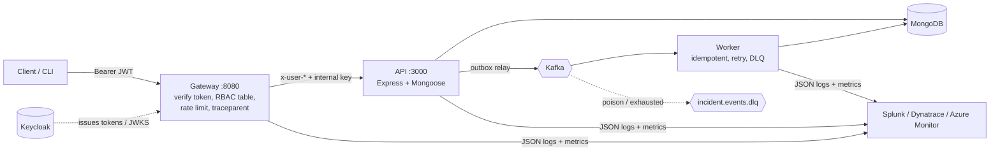

# OpsBridge: incident-management platform

An API platform built to exercise, end to end: REST APIs with authentication and RBAC, an API gateway enforcing security at the entry point, Kafka event-driven integration with resilience patterns, structured logging and tracing for Splunk/Dynatrace, Python automation for log analysis, Azure infrastructure as code, and CI/CD on four systems. Everything marked **verified** below was actually run.



## What it does
Teams open **incidents** (sev1-4), move them through `open → investigating → mitigated → resolved`, add timeline notes, and see stats incl. MTTR. A root cause is required to resolve. Every change emits a domain event; the worker keeps an immutable **audit trail** and can page a webhook for sev1/sev2.

| Role | Can do |
|---|---|
| viewer | read incidents, stats |
| engineer | + create, update, notes, read audit |
| admin | + delete, chaos controls |

## Repo map
| Path | Purpose |
|---|---|
| `services/api` | REST API: auth (bcrypt + JWT), CRUD, validation, central error handling, outbox |
| `services/gateway` | entry point: JWT/Keycloak verification, deny-by-default policy, rate limiting, trace propagation |
| `services/worker` | Kafka consumer: idempotency, backoff retry, dead-letter queue |
| `packages/common` | structured logger (+Splunk HEC), W3C trace context, Prometheus metrics |
| `tools/logtriage` | Python: spike detection, error signatures, change correlation, RCA draft |
| `tools/smoke_test.py`, `tools/drill.py` | post-deploy gate; fault-injection drill |
| `infra/terraform`, `infra/bicep`, `infra/ansible` | Azure IaC and VM deployment; Terraform includes VNet, NSGs, private endpoints and private DNS ([design](docs/azure-networking.md)) |
| `.github/workflows`, `pipelines/` | GitHub Actions, Azure DevOps, GitLab CI, Jenkins |
| `docs/` | runbook, incident drill, observability, Azure networking |

## Run it
Needs Docker, Node 22+, Python 3.9+.
```bash
npm install
make up        # gateway, api, worker, mongo, kafka
make seed      # demo users (password from SEED_PASSWORD, default for local dev only)
make smoke     # 16 end-to-end checks
make test      # unit + integration tests (in-memory Mongo)
```
Login and call the API:
```bash
TOKEN=$(curl -s localhost:8080/auth/login -H 'content-type: application/json' \
  -d '{"email":"engineer@opsbridge.local","password":"ChangeMe!12345"}' | python3 -c 'import sys,json;print(json.load(sys.stdin)["accessToken"])')
curl -s localhost:8080/incidents -H "authorization: Bearer $TOKEN"
```
Keycloak mode (tokens from Keycloak, API trusts only the gateway):
```bash
make keycloak-up
KEYCLOAK_TOKEN_URL=http://localhost:8081/realms/opsbridge/protocol/openid-connect/token python3 tools/smoke_test.py
```
Incident drill: see [docs/incident-drill.md](docs/incident-drill.md).

## Verified results
| Check | Result |
|---|---|
| API / gateway / worker / logtriage tests | 22 / 11 / 8 / 14 passing |
| Full stack smoke test, local JWT mode | 16/16 |
| Full stack smoke test, Keycloak mode | 16/16 |
| Kafka down during writes | 3/3 requests `201`; events delivered after broker returned |
| Fault drill diagnosed by `logtriage` | spike + first error + prime suspect found correctly |
| `terraform validate`, `az bicep build`, `ansible-playbook --syntax-check`, pipeline YAML parse | pass |

**Not verified** (needs an Azure subscription / CI servers): `terraform plan/apply`, Ansible against a real VM, the four pipelines executing, Splunk/Dynatrace ingestion.

## Key design decisions
- **Gateway deny-by-default**: a route absent from `services/gateway/src/policy.js` is a 404 and never reaches the API; client-supplied `x-user-*` headers are stripped and replaced with verified ones.
- **Defence in depth**: the API re-checks roles and, behind the gateway, only trusts identity headers carrying a constant-time-compared internal key.
- **Transactional outbox**: broker outages never fail user requests; delivery is at-least-once with exponential backoff, consumers de-duplicate on `eventId`. (On standalone Mongo the two writes aren't one transaction; use a replica set / Cosmos transactions to close that gap.)
- **Cosmos DB for MongoDB** in Terraform keeps the data tier wire-compatible with the app; **Event Hubs' Kafka endpoint** replaces Kafka on Azure with no code change (`KAFKA_SSL`/`KAFKA_SASL_*`).
- Secrets live only in Key Vault; apps read them via Key Vault references using their **managed identity**; no secret appears in app settings or state outputs.
