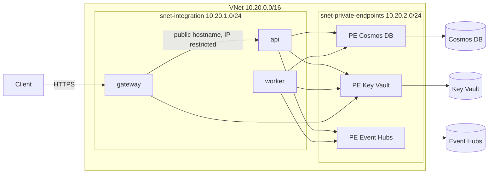

# Azure networking

The Terraform in `infra/terraform/network.tf` puts the data services behind private endpoints and connects the web apps to a VNet. This page describes the design and what has and has not been verified.

## Overview



The web apps use regional VNet integration on `snet-integration`. The three data services each get a private endpoint in `snet-private-endpoints`, and a private DNS zone resolves their service names to those private IPs inside the VNet.

## Network security groups

Both subnets have an NSG. Azure allows all traffic inside a VNet by default, so each NSG ends with an explicit deny.

`snet-private-endpoints` (inbound):

| Priority | Rule | Source | Ports | Action |
|---|---|---|---|---|
| 100 | allow-app-to-services | `snet-integration` | 443, 10255, 9093 | Allow |
| 4096 | deny-all-inbound | any | any | Deny |

`snet-integration` (outbound):

| Priority | Rule | Destination | Ports | Action |
|---|---|---|---|---|
| 100 | allow-to-private-endpoints | `snet-private-endpoints` | 443, 10255, 9093 | Allow |
| 110 | allow-azure-dns | `168.63.129.16` | 53 | Allow |
| 120 | allow-https-internet | Internet | 443 | Allow |
| 4096 | deny-all-outbound | any | any | Deny |

| Port | Service |
|---|---|
| 443 | Key Vault |
| 10255 | Cosmos DB (Mongo API) |
| 9093 | Event Hubs (Kafka) |

`private_endpoint_network_policies` is enabled on `snet-private-endpoints`. Without it Azure does not apply NSG rules to private endpoints.

## Public access

The `private_only` variable (default `false`) disables public network access on Key Vault, Cosmos DB and Event Hubs.

It defaults to `false` because Terraform writes Key Vault secrets over the data plane. With public access disabled, a runner outside the VNet cannot do that, so enabling it requires a self-hosted runner or a VPN to reach the VNet.

```hcl
private_only = true
```

## Design notes

- The web apps use `vnet_route_all_enabled = false`. Only traffic to private IPs (the private endpoints) goes through the VNet. Internet traffic leaves the apps as before, so the API's IP restriction, which allows the gateway's outbound IPs, keeps working.
- The data services keep their own TLS and authentication settings. The private endpoints add a network boundary, they do not replace authentication.

## Verification status

Verified:

- `terraform fmt -check` and `terraform validate` pass.

Not verified (needs an Azure subscription):

- `terraform plan` and `terraform apply`.
- Key Vault reference resolution through the private endpoint while `vnet_route_all_enabled` is `false`.
- NSG rules and private DNS resolution in a live environment.
